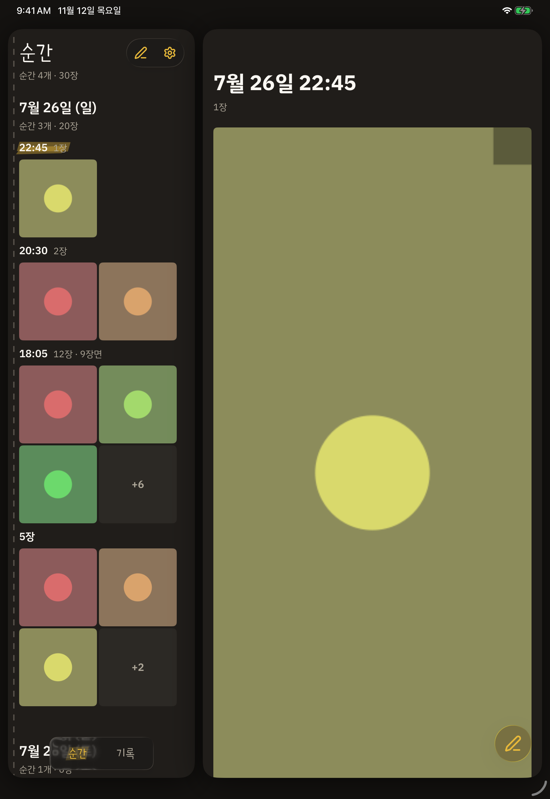
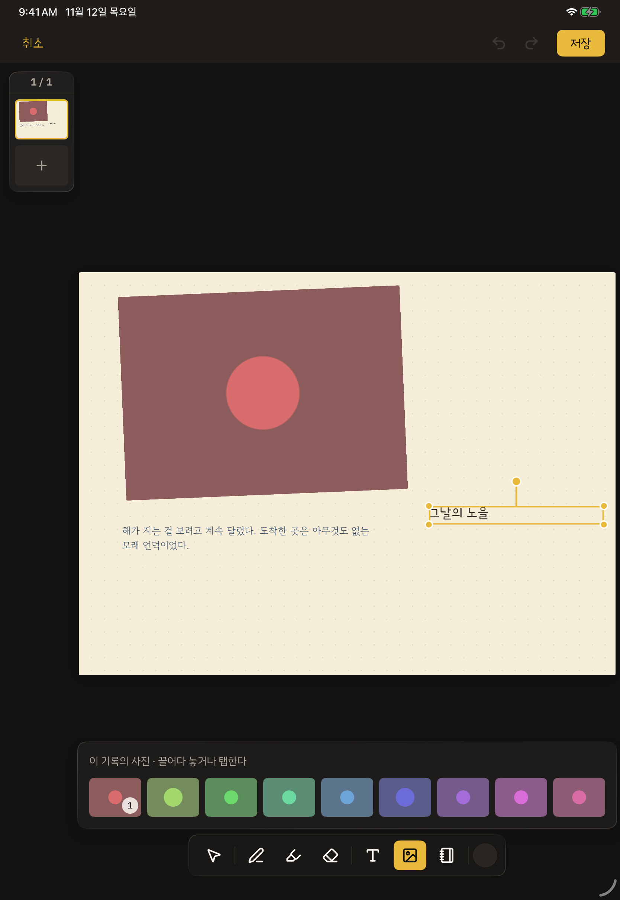
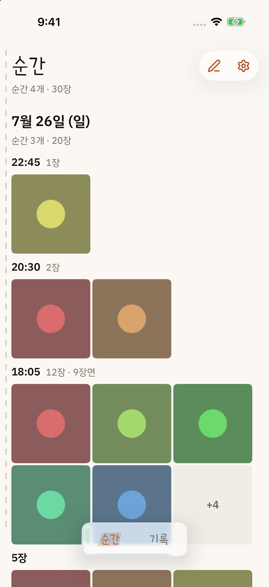

# 모아노기 `moanogi`

게임 스크린샷을 자동으로 분류해 되돌아보고, 남기고 싶은 순간을 일기장처럼 꾸며
기록으로 남기는 앱. SwiftUI 네이티브다 — iPadOS가 기준이고 iPhone과 macOS가 같은
코드베이스에서 선다. `project-mme`는 코드명이다.

<p>
  
  
  
</p>

화면 속 사진은 합성 데이터다. **분류는 진짜 커널이 한다** — 아래 「띄워 보기」의 명령으로
같은 화면이 뜬다.

## 이 저장소가 보이려는 것

이직용 포트폴리오다 — 목표 포지션은 iOS 네이티브.

**아키텍처 경계를 기계가 강제하게 만드는 설계.** 경계가 취향이 아니라 문제 구조에서
나왔음을 보인다 — 그리고 그 강제가 실제로 돈다.

## 10분 안에 확인하는 길

**먼저 게이트를 돌려 두고, 도는 동안 아래 표의 파일을 연다.**

```bash
apple/scripts/gates.sh
```

게이트 전량이 이 파일 하나다 — 경계 검증기 · 패키지 테스트 둘 · iOS 빌드 · macOS 빌드 ·
시뮬레이터 앱 테스트, 그리고 grep 한 줄짜리 기계 대조 넷. 하한은 iOS 26 · macOS 26이고
iOS 26 이상 시뮬레이터가 하나 있어야 한다.

| 주장 | 여는 파일 (`apple/` 아래) | 무엇이 지키는가 |
|---|---|---|
| 분류 커널은 순수 함수고 **import가 0**이다 — 플랫폼·시간대·로케일을 모른다 | `Packages/MomentKernel/Sources/MomentKernel/Classifier.swift` | 검증기 ① |
| 사진 라이브러리를 아는 모듈은 `PhotoSource` 하나고 **공개 API에 쓰기 연산이 없다** | `Packages/PhotoSource/Sources/PhotoSource/AlbumPhotoSource.swift` | 검증기 ② ③ |
| 두 패키지는 서로를 모른다 — 읽기와 분류를 잇는 일은 `App`의 오케스트레이터가 한다 | `Packages/PhotoSource/Package.swift` · `App/Data/MomentLibrary.swift` | 컴파일러 |
| 검증기는 3항목만 본다 — 컴파일러가 못 막는 것만 | `scripts/verify-boundaries.swift` | 첫 게이트 |
| 시각의 출처는 둘이고 순서가 있다 — 날짜만 가진 사진은 시간축에 안 놓인다 | `Packages/MomentKernel/Tests/MomentKernelTests/ClassifierTests.swift` | 테스트 이름이 요구를 말한다 |
| 캔버스의 획(PencilKit)과 요소가 되돌리기 스택 하나에 오른다 | `App/Screens/Canvas/DrawingLayer.swift` · `App/Data/CanvasSession.swift` | `AppTests/CanvasSessionTests.swift` |
| 캔버스 페이지 한 장이 기록의 이미지 한 장으로 구워진다 — 화면과 같은 조각으로 그린다 | `App/Screens/Canvas/CanvasBaker.swift` | `AppTests/CanvasBakerTests.swift` |
| macOS에 없는 iOS 어휘는 한 파일이 메운다 — 화면은 사용자가 보는 것이 다를 때만 가른다 | `App/Design/MacVocabulary.swift` | macOS 빌드 게이트 |
| 게시·지우기가 실패하면 호출자가 받고 화면이 알린다 | `App/Data/RecordLibrary.swift` · `App/Components/WriteFailureAlert.swift` | `AppTests/RecordLibraryTests.swift` |

### 띄워 보기

사진 권한도 앨범도 필요 없다 — `-fixture`가 합성 데이터로 앱 전체를 띄운다.
Xcode에서는 `Moanogi` 스킴의 실행 인자에 `-fixture`를 더한다. 명령줄에서는
시뮬레이터를 하나 띄워 둔 뒤 —

```bash
cd apple
xcodebuild build -project Moanogi.xcodeproj -scheme Moanogi \
    -destination 'generic/platform=iOS Simulator' \
    -derivedDataPath DerivedData CODE_SIGNING_ALLOWED=NO
xcrun simctl install booted DerivedData/Build/Products/Debug-iphonesimulator/Moanogi.app
xcrun simctl launch booted dev.placeholder.moanogi1 -fixture
```

`-fixture 11-text`는 캔버스를, `-fixture 08`은 기록 상세를 바로 연다. 인자 전체는
`apple/App/MoanogiApp.swift`의 `rootScreen`에 있다. 디버그 빌드에만 있는 문이다.

## 구조

```
┌──────────────────────────────────┐
│ App — 화면 · 내비 · 오케스트레이션 │
└───────┬──────────────┬───────────┘
        ▼              ▼
 ┌─────────────┐  ┌──────────────┐
 │ PhotoSource │  │ MomentKernel │
 │ Photos 유일 │  │   import 0   │
 └─────────────┘  └──────────────┘
```

- **`MomentKernel`** — 자동 분류. 순수 함수, **import 0**. 픽셀을 디코딩하지 않는다 — 분류 신호는 파일이 든 값에서만 온다
- **`PhotoSource`** — 사진 라이브러리를 아는 유일한 모듈. **공개 API에 쓰기 연산이 없다**
  — 원본 불변이 테스트가 아니라 구조로 보장된다
- **`PhotoSourceUI`** — 사용자가 직접 건네는 사진. 같은 패키지의 다른 타깃이고 `PhotoSource`에 의존하지 않는다
- 구조의 진실은 `apple/Packages/*/Package.swift`다. 위 그림은 결정 시점의 스냅샷이다

**경계는 세 층이 지킨다** — 컴파일러(패키지 간 화살표) · 직접 만든
검증기(컴파일러가 못 막는 3항목) · 사람(의미 층).

검증기는 **두 시점**에 돈다 — 수정 직후 편집 훅(`apple/scripts/verify-boundaries-hook.sh`)으로,
그리고 커밋 전 `apple/scripts/gates.sh`로. 훅은 알림이고 차단은 게이트가 한다.

## 규칙과 계약

`docs/rules.md` 한 장이다 — 코드·주석 규칙과, 맨 앞의 **기계가 못 막는 계약 셋**.
로직을 건드리기 전에 그 셋부터 읽는다. **그 문서에 없는 것은 규칙이 아니다.**

## 여기 없는 것

- **서버가 없다.** 기록은 기기에 저장되고, 내보내기는 시스템 공유 시트다. 링크 공유와 웹 쪽은 다음 버전이다
- **macOS는 빌드되고 iPad 판이 뜨는 데까지다.** 캔버스가 없고 macOS 화면설계도 없다
- **CI가 안 돈다.** 저장소가 비공개라 Actions를 껐다. `.github/workflows/ci.yml`은 `gates.sh`를 부르는 한 줄로 남아 있다
- **분류 임계값의 근거는 저장소 밖이다.** 실기기에서 실물 사진 전량으로 판정했고, 그 사진은 개인 데이터라 올리지 않는다. 값이 사는 자리는 `Classifier.swift`의 `Settings`다
- **배포하지 않았다.** 번들 ID가 자리표시자다

## 기획·설계 문서는 왜 없는가

판단이지 누락이 아니다. 기획서·화면설계서·실험 기록은 비공개 워크스페이스에 있다.
구현과 함께 낡는 명세를 코드 저장소에 남기면 코드보다 문서가 먼저 눈에 띈다 —
저장소가 증명하는 것은 코드·테스트·게이트·커밋 히스토리다.
